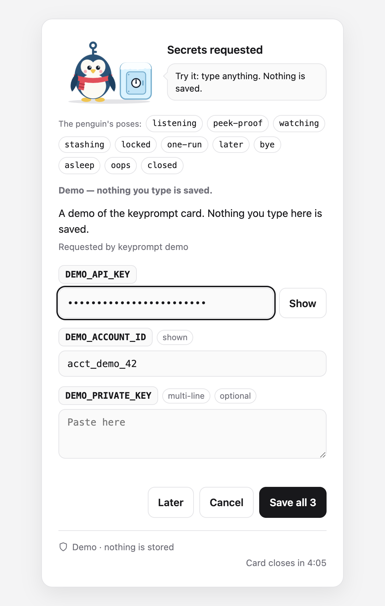
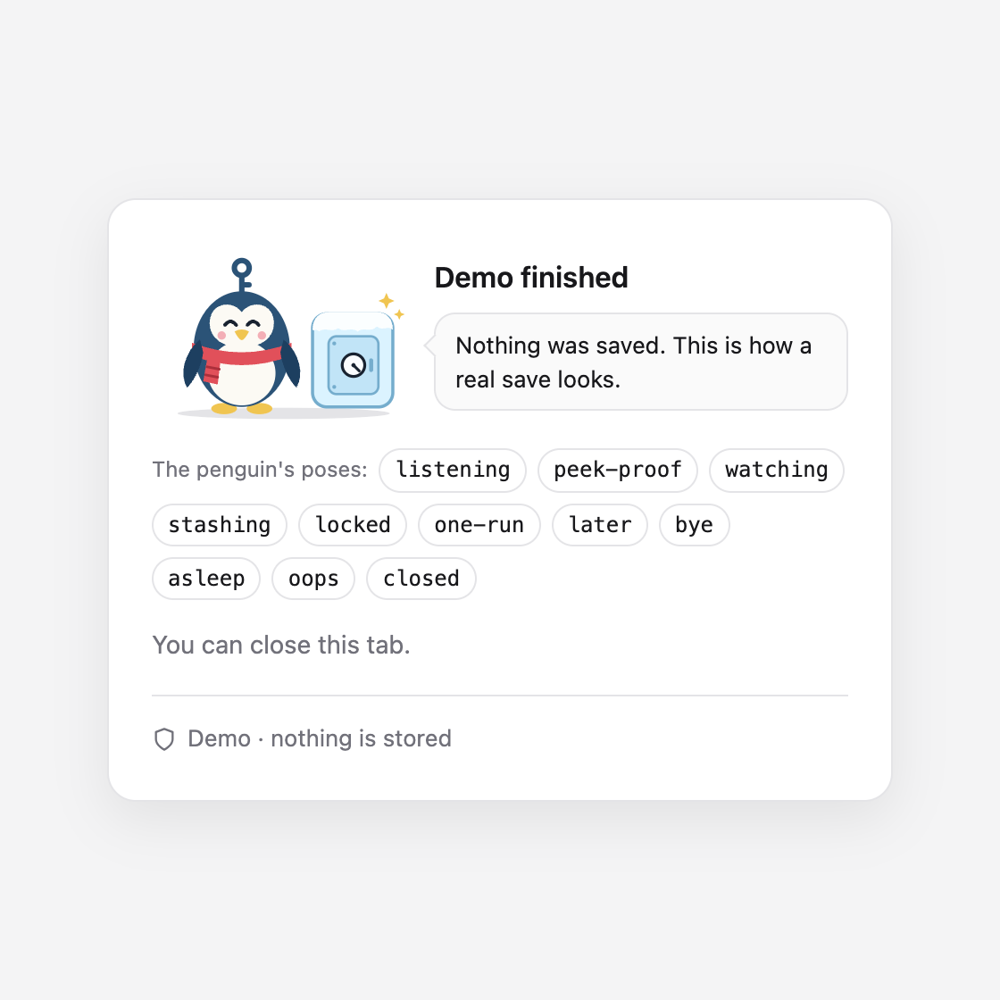

# keyprompt

**Give API keys to AI coding agents without pasting them into the chat.**

```sh
npm install -g keyprompt   # 1. install it
keyprompt install-skill    # 2. teach Claude Code to use it
keyprompt demo             # 3. see the card (nothing is saved)
```

Needs Node.js 18.17 or later. On Linux, also install `secret-tool`: see [Install](#install).

<!-- The pictures use full links pinned to one commit, so they also show on the npm page, which does not reliably resolve paths inside the repo. After changing a picture, merge it first, then point both links at a commit on main that has the new one (this repo squash-merges, so a commit on the picture's own branch is not on main). -->
<p align="center">
  
  &nbsp;
  
</p>

<p align="center"><sub><code>keyprompt demo</code> opens this card. Nothing you type in it is saved.</sub></p>

When an agent (Claude Code, Codex, Cursor, …) needs a key, it runs one command. A secure card opens in your browser, you paste the key there, and it goes straight into your computer's password store: the macOS Keychain, Windows Credential Manager, or the Linux keyring. After that the agent runs its commands through `keyprompt run`, which hands the key to that one command. keyprompt has no command that prints a saved key back, and [SECURITY.md](https://github.com/abhisheksharma001/keyprompt/blob/main/SECURITY.md) says plainly what it does not cover.

## Why

A key pasted into an AI chat is in the conversation log for good: in the transcript, in the model's context, often synced to the cloud. You can't take it back, so the only safe fix is to rotate the key. keyprompt makes the safe path the easy one:

- **The value never enters the chat.** It travels from your clipboard to the card to the OS password store.
- **Keys go into a command, not into the chat.** `keyprompt run` puts a key into one command's environment and masks copies of it in that command's output: the exact value and a few common encodings of it (not with `--no-redact`). A command can still transform or send it; see [SECURITY.md](https://github.com/abhisheksharma001/keyprompt/blob/main/SECURITY.md).
- **There is no "get" command.** keyprompt has no command that prints a saved key back.
- **Works on Windows, macOS and Linux**, with nothing to sign up for and no cloud service.

## Install

Needs Node.js 18.17 or later.

```sh
npm install -g keyprompt
keyprompt install-skill        # teach Claude Code to use it
```

Or run it without installing: `npx -y keyprompt <command>`.

On Linux, also install `secret-tool`: `sudo apt install libsecret-tools` (Debian/Ubuntu) or `sudo dnf install libsecret` (Fedora). macOS and Windows need nothing extra.

## How it works for you

1. You ask your agent to do something that needs a key ("run the eval", "deploy to Fly").
2. The agent runs `keyprompt set OPENAI_API_KEY --reason "..."` and tells you a card opened.
3. You paste the key into the card and click **Save securely**. Not now? Click **Later**: nothing is saved and the agent is told you chose Later.
4. From then on the agent runs commands with the key, e.g. `keyprompt run OPENAI_API_KEY -- python eval.py`: the key goes to that command, not into the chat. Next week, in a new chat, it's still there: no popup.

## Commands

| Command | What it does |
|---|---|
| `keyprompt set FIELD [FIELD...] [--reason TEXT]` | Opens one secret card for all the fields. Saves the values in the OS password store. Waits until you save, cancel or choose **Later**. If a name already exists, the card says **Replace secret**; the old value is never shown, and a box you leave empty keeps its saved value. |
| `keyprompt run FIELD[,FIELD...] -- COMMAND` | Runs COMMAND with `$NAME` set for each name. Names that aren't saved yet open one card first, where you can untick **Remember on this computer** to use a value for this run only. Exact copies of the values in COMMAND's output appear as `[keyprompt:NAME]`. |
| `keyprompt setup [--from FILE]` | Reads the names a project needs from its `.env.example` (or FILE) and opens one card for the ones not saved yet. See [Set up a project](#set-up-a-project). |
| `keyprompt has NAME` | Exit 0 if saved, 3 if not. Never shows the value. |
| `keyprompt list` | Saved names, reasons and dates. Never values. |
| `keyprompt delete NAME` | Removes it from the password store. |
| `keyprompt log` | The newest 50 lines of the activity log: when each name was saved, given to which program, deleted or put off. Never values. See [Activity log](#activity-log). |
| `keyprompt mcp` | A small MCP server for agents that call MCP tools: one tool asks for keys on the card, one checks which are saved. Never returns a value. See [MCP](#mcp). |
| `keyprompt install-skill` | Installs the Claude Code skill (`~/.claude/skills/keyprompt/SKILL.md`). |
| `keyprompt install-guard [--yes]` | Adds keyprompt's guard to Claude Code's settings (see [Guard for Claude Code](#guard-for-claude-code)). Shows the entries first and asks; `--yes` skips the question. |
| `keyprompt uninstall-guard` | Removes the guard again. Works only in your own terminal, and always asks. |
| `keyprompt guard EVENT` | Run by Claude Code's hooks, not by you. Reads the hook's JSON on stdin; never reads a saved value. |
| `keyprompt demo` | Opens a sample card with three boxes, so you can see how it looks. Nothing you type is saved. Save, **Later** and Cancel all end it with exit code 0. |

Names look like environment variables (`OPENAI_API_KEY`, `STRIPE_SECRET_KEY`), because that's what `run` sets.

A **FIELD** is a name plus optional hints after a colon, for example `keyprompt set TWILIO_ACCOUNT_SID:visible TWILIO_AUTH_TOKEN`. Up to 12 fields go on one card; separate them with spaces or commas.

| Hint | What the box does |
|---|---|
| `:visible` | Shows what you type. For an ID that isn't secret. |
| `:multiline` | A paste box that keeps line breaks (a PEM key, a JSON key file). |
| `:optional` | May stay empty. On `run`, when every box on the card is optional, Save works with all of them empty: nothing is saved, and keyprompt gives the command no value for them. `set` needs at least one value. |

The agent picks the hints, and they only change how a box looks on the card: every value is still saved the same way and masked in `run`'s output. A `:visible` box shows what you type, so only put an ID there.

Options: `--reason TEXT` (shown on the card: why it's needed), `--by TEXT` (shown on the card: who's asking), `--from FILE` (for `setup`: the example file to read), `--json` (one line of JSON instead of sentences, for agents: see [JSON results](#json-results)), `--no-redact` (pass output through untouched, for a full-screen program in your own terminal; refused when the output is not a terminal).

Exit codes:

| Code | Meaning |
|---|---|
| `0` | OK. |
| `1` | Something failed; the message says what. |
| `2` | Bad usage: an unknown option, a bad name, a bad hint, an example file `setup` will not read, or `--no-redact` when the output is not a terminal. |
| `3` | Not saved (`keyprompt has`, or `keyprompt delete` of a name that wasn't saved). |
| `4` | You cancelled the card, or said no to `install-guard` or `uninstall-guard`. |
| `5` | Nobody filled in the card within 5 minutes. |
| `6` | You chose **Later**. Nothing was saved. |

Once the command in `keyprompt run` has started, `run` exits with the command's own exit code. If it stops before that, it says why in a message that starts with `keyprompt:`, and the exit code is one from the table (for example 4, 5 or 6).

## Set up a project

A project usually lists the keys it needs in `.env.example`. Run this in the project's folder:

```sh
keyprompt setup --reason "Run this project locally"
```

keyprompt reads the names from `.env.example` (or from the file `--from FILE` names), skips the ones already saved, and opens one card for the rest. Every box may stay empty, so you fill in the keys you have; Save needs at least one value. For an `.env.example` that lists `OPENAI_API_KEY`, `STRIPE_SECRET_KEY` and `STRIPE_WEBHOOK_SECRET`, with `OPENAI_API_KEY` already saved and only the Stripe secret key filled in, it prints (on a Mac):

```text
keyprompt: opened a secure card in the browser for STRIPE_SECRET_KEY and STRIPE_WEBHOOK_SECRET. Waiting for it to be filled in...
Saved STRIPE_SECRET_KEY in the macOS Keychain. The value was not shown here.
Left empty, so still not saved: STRIPE_WEBHOOK_SECRET.
Already saved, so not asked: OPENAI_API_KEY.
Use them with: keyprompt run OPENAI_API_KEY,STRIPE_SECRET_KEY -- <command>
```

- **Only the names are read.** A line counts when it looks like `NAME=...`, with or without `export ` in front. keyprompt keeps the part before `=` and ignores the value, even a sample one. A line it cannot use (a lowercase name, say) is reported by its line number, never its text. When every name is saved already, no card opens.
- **Only a template is read.** The file's name must contain example, sample, template, schema or dist (`.env.example`, `example.env`, `.env.local.example`). `.env`, `.env.local` and every other file are refused with exit 2 before they are opened, because they may hold real keys.
- **One card holds 12 boxes.** With more than 12 names missing, it asks for the first 12 in the file's order and lists the others as not asked yet; run `keyprompt setup` again for them.
- **Every box is a hidden one.** A name that is not a secret (a port, say) can stay empty. For a value with line breaks, such as a PEM key, use `keyprompt set NAME:multiline`.
- **Nothing is written into the project.** The keys go to the OS password store, as with `set`.

## For agents

**Claude Code:** run `keyprompt install-skill` once. The skill tells Claude never to ask for keys in chat and to use `keyprompt` instead. To also have Claude Code refuse the obvious direct reads of saved keys, add the [guard](#guard-for-claude-code).

**Codex, Cursor, Gemini CLI and anything that reads `AGENTS.md`:** add this block to your `AGENTS.md` (project or global):

```markdown
## Secrets (API keys, tokens)
- Never ask the user to paste a secret into the chat, and never print, echo, log or write one to a file.
- To get a secret, run `keyprompt set NAME --reason "<why, in plain words>"` yourself. It opens a secure card in the user's browser and waits; tell the user a card opened.
- Ask for everything you need right now on one card, never for keys you don't need yet: `keyprompt set ACCOUNT_ID:visible SECRET_KEY --reason "..."`. The hints `:visible`, `:multiline` and `:optional` only change how a box looks.
- When the user asks you to set up or run a project that has a `.env.example`, run `keyprompt setup --reason "..."` in its folder instead: one card asks for every name in it that is not saved yet, and each box may stay empty.
- Add `--json` to `set`, `has`, `list`, `delete`, `setup` or `log` to get one line of JSON with names, a status and the exit code, never values.
- If the exit code is 6, the user chose Later and nothing was saved. Tell them in one line, carry on with work that doesn't need the secret, and ask again only when you are about to use it.
- To use one, run `keyprompt run NAME -- <command>`; the command reads it from `$NAME`. `keyprompt has NAME` checks whether it exists.
- If the user pastes a secret into the chat anyway, tell them it is now exposed and should be rotated, then store the new one with `keyprompt set`.
- If `keyprompt` is not installed, use `npx -y keyprompt` instead.
```

Using a key as a command-line argument (an `Authorization` header, say)? Let a shell inside `run` expand it, so the value never appears in the agent's own command:

```sh
keyprompt run API_TOKEN -- sh -c 'curl -sS -H "Authorization: Bearer $API_TOKEN" https://api.example.com/me'
```

On Windows: `keyprompt run API_TOKEN -- powershell -NoProfile -Command "Invoke-RestMethod https://api.example.com/me -Headers @{Authorization = 'Bearer ' + $env:API_TOKEN}"`

### JSON results

Add `--json` to `set`, `has`, `list`, `delete`, `setup` or `log` and keyprompt prints one line of JSON on stdout instead of sentences, failures included. The exit codes stay the same, and the line saying a card opened still goes to stderr. A result never holds a value, a reason or what a password-store tool printed.

```sh
keyprompt has OPENAI_API_KEY --json
```

```json
{"command":"has","status":"saved","names":["OPENAI_API_KEY"],"exitCode":0}
```

| Field | What it holds |
|---|---|
| `command` | `set`, `has`, `list`, `delete`, `setup` or `log`; `null` when the command was none of them. |
| `status` | `saved`, `listed` (`list` and `log`) or `deleted` (exit 0), `error` (1), `invalid_usage` (2), `missing` (3), `cancelled` (4), `timed_out` (5), `deferred` (6). |
| `names` | The names the result is about. After a successful `set` or `setup`, only the names saved now. For `list`, the names on keyprompt's list of names, not checked against the store. For `log`, the names in the lines shown. |
| `exitCode` | The process's exit code. |
| `replaced`, `empty` | `set` and `setup`: names whose saved value was replaced, and boxes left empty. |
| `warnings` | `set`, `setup` and `delete`: `["catalog_not_updated"]` when the key was saved or deleted but the list of names `keyprompt list` reads could not be updated; otherwise `[]`. |
| `skipped`, `remaining`, `ignoredLines` | `setup`: names already saved, names left for the next card, and the line numbers it could not use. |
| `entries` | `log`: the lines shown, oldest first, as they are in the file (see [Activity log](#activity-log)). |
| `message` | Failures only: why, in keyprompt's own words. Anything keyprompt did not write itself, such as an invalid name you typed or a store tool's error line, is left out. |

The person chose **Later**:

```json
{"command":"set","status":"deferred","names":["STRIPE_SECRET_KEY"],"exitCode":6,"message":"The person chose Later for STRIPE_SECRET_KEY. Nothing was saved."}
```

`setup --json`, for the example under [Set up a project](#set-up-a-project):

```json
{"command":"setup","status":"saved","names":["STRIPE_SECRET_KEY"],"exitCode":0,"replaced":[],"empty":["STRIPE_WEBHOOK_SECRET"],"warnings":[],"skipped":["OPENAI_API_KEY"],"remaining":[],"ignoredLines":[]}
```

`run` does not take `--json`, because its stdout is the command's own output: given `--json` before `--`, it stops with exit 2 before anything runs.

### MCP

`keyprompt mcp` is a small MCP server that runs on your computer, for agents that call MCP tools. It has two tools, and neither returns a value:

- **`request_secret`** opens the same card as `keyprompt set` for up to 12 fields (with the same hints) and waits until you press Save, Cancel or **Later**, for at most 5 minutes. It answers with the same result as `keyprompt set --json`.
- **`check_secrets`** says which names are saved, like `keyprompt has`.

MCP only asks for keys and checks them. A saved key still reaches a program through `keyprompt run NAME -- COMMAND` in a shell. If the agent cancels the call or its connection closes, the card closes (within 5 seconds of the connection closing), and if the card had opened the activity log says the agent withdrew it; a save you had already pressed still finishes.

Add it to your agent, with keyprompt installed by `npm install -g keyprompt`:

**Claude Code:**

```sh
claude mcp add keyprompt -- keyprompt mcp
```

**VS Code:** in `.vscode/mcp.json` in your project, or in your user `mcp.json` (**MCP: Open User Configuration**):

```json
{
  "servers": {
    "keyprompt": { "type": "stdio", "command": "keyprompt", "args": ["mcp"] }
  }
}
```

**Cursor:** in `.cursor/mcp.json` in your project, or `~/.cursor/mcp.json`:

```json
{
  "mcpServers": {
    "keyprompt": { "command": "keyprompt", "args": ["mcp"] }
  }
}
```

**Codex:**

```sh
codex mcp add keyprompt -- keyprompt mcp
```

Codex 0.167.0 waits 300 seconds for a tool call by default, the same as the card's 5 minutes. To leave room, add `tool_timeout_sec = 360` under `[mcp_servers.keyprompt]` in `~/.codex/config.toml`.

These lines follow each client's own documentation or source as of 2026-11-09. Only Claude Code (2.1.319, on macOS) has been run against `keyprompt mcp` so far.

## Guard for Claude Code

The skill asks Claude not to read a saved key straight from your password store. The guard makes Claude Code refuse the obvious ways of doing it. It is optional, and it works in Claude Code only.

```sh
keyprompt install-guard      # shows what it adds, then asks
keyprompt uninstall-guard    # removes it again (only in your own terminal)
```

`install-guard` adds two hook entries to Claude Code's user settings, `~/.claude/settings.json` (or `$CLAUDE_CONFIG_DIR/settings.json` when that is set), and leaves every other setting as it is. Before it asks, it prints the file and the entries with their real paths; `--yes` skips the question. Running it again never adds a second copy. The entries look like this:

```json
{
  "hooks": {
    "PreToolUse": [
      {
        "matcher": "Bash|PowerShell",
        "hooks": [
          {
            "type": "command",
            "command": "/absolute/path/to/node",
            "args": ["/absolute/path/to/keyprompt/bin/keyprompt.mjs", "guard", "pre-tool-use"],
            "timeout": 10
          }
        ]
      }
    ],
    "UserPromptSubmit": [
      {
        "hooks": [
          {
            "type": "command",
            "command": "/absolute/path/to/node",
            "args": ["/absolute/path/to/keyprompt/bin/keyprompt.mjs", "guard", "user-prompt-submit"],
            "timeout": 10
          }
        ]
      }
    ]
  }
}
```

What the guard does:

- **Before each Bash or PowerShell command**, it refuses a command that runs the password store's own read tool on a keyprompt item: `security find-generic-password` with `-w` or `-g`, or `security dump-keychain -d` (macOS); `secret-tool lookup` or `search` (Linux); `Get-StoredCredential`, or CredRead through `Add-Type` (Windows). Claude is told to use `keyprompt run` instead. A command that only mentions those words, such as `git grep find-generic-password` or an `echo`, goes through.
- **Before each message**, it warns when the message looks like it contains a key (an Anthropic, OpenAI, GitHub or Slack key, a live Stripe secret or restricted key, another key starting `sk-`, or a private key block). The warning names the kind of key and never repeats it. It never blocks a message, so the key has already reached Claude: rotate it.

What it does not do:

- **It reads command text only.** A script file, an encoded command or another tool can still get round it, and an agent that can edit Claude Code's settings file can remove it. It is a guardrail, not a wall; [SECURITY.md](https://github.com/abhisheksharma001/keyprompt/blob/main/SECURITY.md) has the details. It can also refuse a harmless command that holds one of those reads as text, such as a `cat <<EOF` block written to a file.
- **It fails open.** If it cannot run (the Node version it points at was removed, with `nvm uninstall` for example, or keyprompt was uninstalled), Claude Code lets every command through and shows a hook error. Run `keyprompt install-guard` again.
- **It cannot be installed from `npx`**, whose folder npm can delete at any time. Install keyprompt with `npm install -g keyprompt` first.

If you start Claude Code with `CLAUDE_CONFIG_DIR` set (in an alias, say), run `install-guard` with the same value, for example `CLAUDE_CONFIG_DIR="$HOME/.claude-work" keyprompt install-guard`. Otherwise it writes `~/.claude/settings.json`, which that Claude Code does not read.

**Stricter, by hand:** to make Claude Code refuse every Bash and PowerShell command while the guard cannot run, add `"onFailure": "block"` next to `"timeout": 10` in the `PreToolUse` entry (Claude Code 2.1.295 or later). keyprompt leaves it out because a broken install would then stop every command until you fix it. Running `install-guard` again replaces keyprompt's entries and drops that line, so add it again afterwards.

## Where keys are stored

| OS | Store | Item |
|---|---|---|
| macOS | Login Keychain (Keychain Access app) | service `keyprompt`, account `NAME` |
| Windows | Credential Manager → Windows Credentials | generic credential `keyprompt:NAME` |
| Linux | Secret Service (GNOME Keyring / KWallet) | attributes `service=keyprompt account=NAME` |

You can see or delete them there yourself at any time. `~/.keyprompt/catalog.json` keeps names, reasons and dates for `keyprompt list`, and `~/.keyprompt/activity.jsonl` keeps the activity log; neither holds a value.

## Activity log

keyprompt keeps a names-only record of what it did with each key. `keyprompt log` shows the newest 50 lines, in your local time (your dates and folders will differ):

```text
2026-11-09 17:54  Saved STRIPE_SECRET_KEY (setup), in /Users/you/code/shop
2026-11-09 17:54  Gave OPENAI_API_KEY and STRIPE_SECRET_KEY to node, which exited with 0, in /Users/you/code/shop
2026-11-09 17:54  The person chose Later for SENTRY_DSN (set), in /Users/you/code/shop
Shown: all 3 lines. The log is /Users/you/.keyprompt/activity.jsonl; it keeps the newest 1000 and never a value.
```

- **What writes a line:** a save (by `set`, `setup`, the card `run` opens with **Remember on this computer** ticked, or the MCP tool `request_secret`); `run` giving names to a command, written when the command ends, with its exit code; a `delete` that removed a value; a card that ended with **Later**, Cancel or no answer within 5 minutes; and a card an MCP client withdrew (it cancelled `request_secret` or closed its connection). `has`, `list`, `log` and `demo` write nothing.
- **What a line holds:** the time, what happened, the keyprompt command, the names, the exit code and the folder keyprompt ran in; for `run`, also the program's own name (`node`, not its folder). Never a value, a reason, the command's arguments (they can hold another secret or a client's data), its output or its environment.
- **Size:** the file keeps the newest 1,000 lines, as long as keyprompt can make the lock file it uses to trim it. If it cannot (something that is not a file is at its path, or keyprompt's folder cannot be written but the log can), nothing trims the log and it grows past 1,000 lines. keyprompt processes running at once take turns to trim it; [SECURITY.md](https://github.com/abhisheksharma001/keyprompt/blob/main/SECURITY.md) says when a line can still be lost.
- **Shown safely:** in `keyprompt log`, control and invisible characters in a folder or program name appear as `?`. `--json` keeps the text, escaped: DEL, C1 and invisible characters as `\u` escapes, the rest as JSON always escapes them (`\t`, `\n`, `\u001b`).
- **On and silent:** writing a line prints nothing, and if the log cannot be written the command carries on as usual. To empty it, delete the file.
- `keyprompt log --json` gives the lines shown as `entries`: one object each, such as `{"time":"2026-11-09T12:24:55.206Z","event":"run","command":"run","names":["OPENAI_API_KEY","STRIPE_SECRET_KEY"],"exitCode":0,"program":"node","folder":"/Users/you/code/shop"}`. `event` is `saved`, `run`, `deleted`, `deferred`, `cancelled`, `timed_out` or `withdrawn`.

## Limits

- Needs a desktop session to open the card. Over plain SSH or in CI it stops with a clear message; use that environment's own secret store (GitHub Actions secrets, for example).
- Masking catches the exact value and, for a value of 8 or more characters, its base64, base64url, lowercase hex, URL-encoded and JSON-escaped forms, including its base64 inside longer base64, such as the `Authorization: Basic` line of `curl -v -u user:KEY`, where up to 4 bits of the key's first and last bytes can still show ([SECURITY.md](https://github.com/abhisheksharma001/keyprompt/blob/main/SECURITY.md) has the exact list). A program that prints a key any other way (only partly, hashed, or in another encoding) is usually not masked, so agents must still not print secrets on purpose.
- The OS password store caps how long one value can be. Windows Credential Manager: 1,280 characters. macOS: about 4,000 bytes on one line, or about 2,000 with line breaks (a shorter name leaves a little more room). Linux: keyprompt allows 65,536 characters; values near that size have not been tested. A value that is too long is refused, and the card says so.
- Line breaks inside a value (a PEM key, say) are kept on macOS, Windows and Linux. CI checks this with short values (up to 160 bytes on Windows and Linux); the size limits above still apply.

See [SECURITY.md](https://github.com/abhisheksharma001/keyprompt/blob/main/SECURITY.md) for exactly what keyprompt protects against and what it doesn't.

## Development

```sh
npm install
npm test                                  # unit tests
KEYPROMPT_STORE_TEST=1 npm test           # plus a real round trip through this machine's password store
```

`KEYPROMPT_BROWSER=/path/to/program` opens the card with a specific browser (or a test driver) instead of the default one.

## License

MIT
