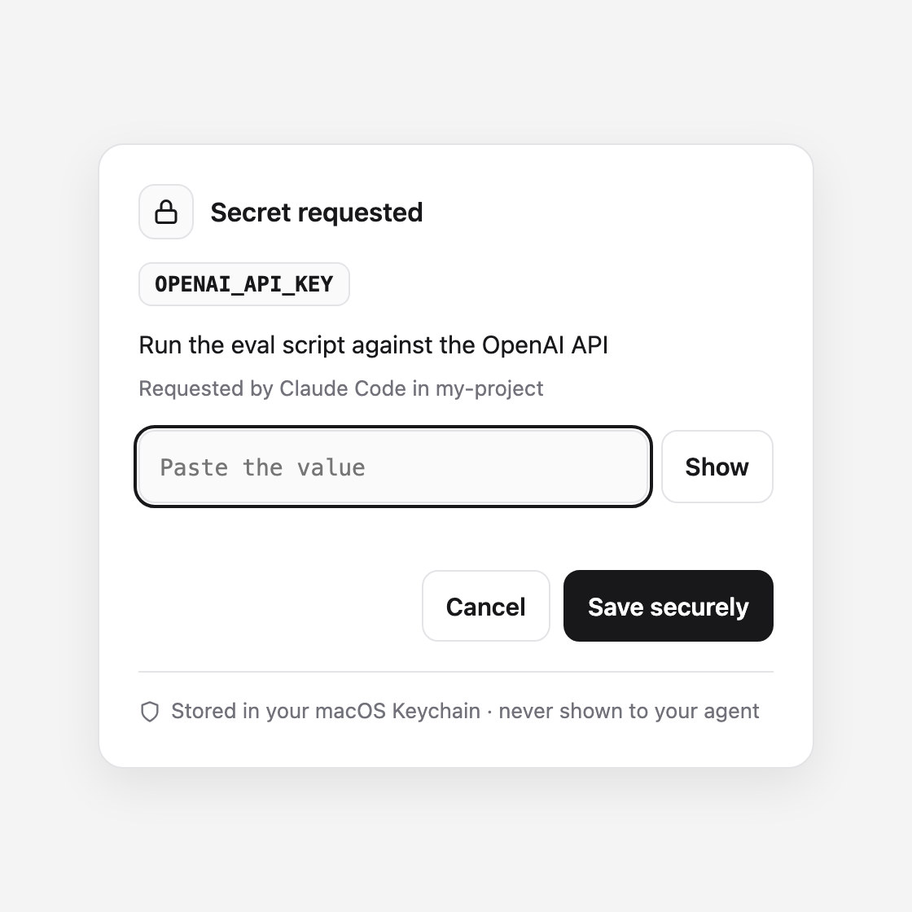
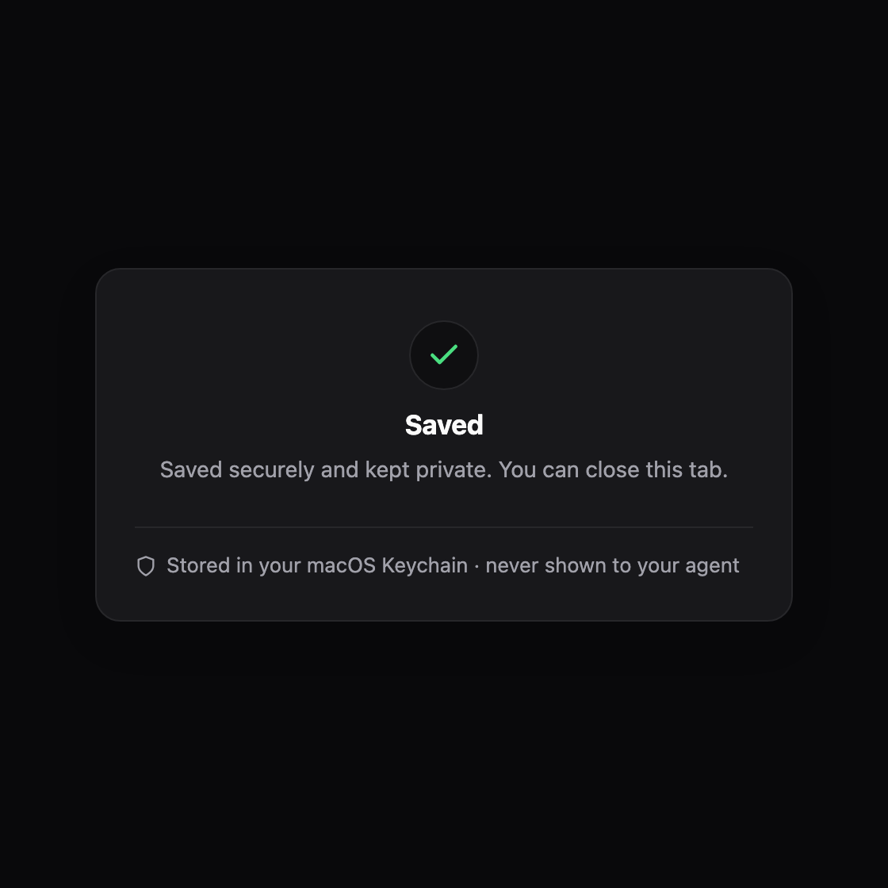

# keyprompt

**Give API keys to AI coding agents without pasting them into the chat.**

When an agent (Claude Code, Codex, Cursor, …) needs a key, it runs one command. A secure card opens in your browser, you paste the key there, and it goes straight into your computer's password store: the macOS Keychain, Windows Credential Manager, or the Linux keyring. The agent then uses the key without ever seeing it.

<p align="center">
  
  &nbsp;
  
</p>

## Why

A key pasted into an AI chat is in the conversation log for good: in the transcript, in the model's context, often synced to the cloud. You can't take it back, so the only safe fix is to rotate the key. keyprompt makes the safe path the easy one:

- **The value never enters the chat.** It travels from your clipboard to the card to the OS password store.
- **Agents use keys, not see them.** `keyprompt run` puts the key into one command's environment and masks any copy of it in that command's output.
- **There is no "get" command.** Nothing prints a saved key, so an agent can't be talked into revealing one.
- **Works on Windows, macOS and Linux**, with nothing to sign up for and no cloud service.

## Install

Needs Node.js 18.17 or later.

```sh
npm install -g github:abhisheksharma001/keyprompt
keyprompt install-skill        # teach Claude Code to use it
```

Or run it without installing: `npx -y github:abhisheksharma001/keyprompt <command>`.

On Linux, also install `secret-tool`: `sudo apt install libsecret-tools` (Debian/Ubuntu) or `sudo dnf install libsecret` (Fedora). macOS and Windows need nothing extra.

## How it works for you

1. You ask your agent to do something that needs a key ("run the eval", "deploy to Fly").
2. The agent runs `keyprompt set OPENAI_API_KEY --reason "..."` and tells you a card opened.
3. You paste the key into the card and click **Save securely**. Not now? Click **Later**: nothing is saved and the agent is told you chose Later.
4. From then on the agent runs commands with the key, e.g. `keyprompt run OPENAI_API_KEY -- python eval.py`, and never sees the value. Next week, in a new chat, it's still there: no popup.

## Commands

| Command | What it does |
|---|---|
| `keyprompt set FIELD [FIELD...] [--reason TEXT]` | Opens one secret card for all the fields. Saves the values in the OS password store. Waits until you save, cancel or choose **Later**. If a name already exists, the card says **Replace secret**; the old value is never shown, and a box you leave empty keeps its saved value. |
| `keyprompt run FIELD[,FIELD...] -- COMMAND` | Runs COMMAND with `$NAME` set for each name. Names that aren't saved yet open one card first, where you can untick **Remember on this computer** to use a value for this run only. Exact copies of the values in COMMAND's output appear as `[keyprompt:NAME]`. |
| `keyprompt has NAME` | Exit 0 if saved, 3 if not. Never shows the value. |
| `keyprompt list` | Saved names, reasons and dates. Never values. |
| `keyprompt delete NAME` | Removes it from the password store. |
| `keyprompt install-skill` | Installs the Claude Code skill (`~/.claude/skills/keyprompt/SKILL.md`). |

Names look like environment variables (`OPENAI_API_KEY`, `STRIPE_SECRET_KEY`), because that's what `run` sets.

A **FIELD** is a name plus optional hints after a colon, for example `keyprompt set TWILIO_ACCOUNT_SID:visible TWILIO_AUTH_TOKEN`. Up to 12 fields go on one card; separate them with spaces or commas.

| Hint | What the box does |
|---|---|
| `:visible` | Shows what you type. For an ID that isn't secret. |
| `:multiline` | A paste box that keeps line breaks (a PEM key, a JSON key file). |
| `:optional` | May stay empty while at least one box on the card is filled in. A card can't be saved with every box empty. |

The agent picks the hints, and they only change how a box looks on the card: every value is still saved the same way and masked in `run`'s output. A `:visible` box shows what you type, so only put an ID there.

Options: `--reason TEXT` (shown on the card: why it's needed), `--by TEXT` (shown on the card: who's asking), `--no-redact` (pass output through untouched, for full-screen terminal programs).

Exit codes:

| Code | Meaning |
|---|---|
| `0` | OK. |
| `1` | Something failed; the message says what. |
| `2` | Bad usage: an unknown option, a bad name or a bad hint. |
| `3` | Not saved (`keyprompt has`, or `keyprompt delete` of a name that wasn't saved). |
| `4` | You cancelled the card. |
| `5` | Nobody filled in the card within 5 minutes. |
| `6` | You chose **Later**. Nothing was saved. |

Once the command in `keyprompt run` has started, `run` exits with the command's own exit code. If it stops before that (4, 5 or 6), it says so in a message that starts with `keyprompt:`.

## For agents

**Claude Code:** run `keyprompt install-skill` once. The skill tells Claude never to ask for keys in chat and to use `keyprompt` instead.

**Codex, Cursor, Gemini CLI and anything that reads `AGENTS.md`:** add this block to your `AGENTS.md` (project or global):

```markdown
## Secrets (API keys, tokens)
- Never ask the user to paste a secret into the chat, and never print, echo, log or write one to a file.
- To get a secret, run `keyprompt set NAME --reason "<why, in plain words>"` yourself. It opens a secure card in the user's browser and waits; tell the user a card opened.
- Ask for everything you need right now on one card, never for keys you don't need yet: `keyprompt set ACCOUNT_ID:visible SECRET_KEY --reason "..."`. The hints `:visible`, `:multiline` and `:optional` only change how a box looks.
- If the exit code is 6, the user chose Later and nothing was saved. Tell them in one line, carry on with work that doesn't need the secret, and ask again only when you are about to use it.
- To use one, run `keyprompt run NAME -- <command>`; the command reads it from `$NAME`. `keyprompt has NAME` checks whether it exists.
- If the user pastes a secret into the chat anyway, tell them it is now exposed and should be rotated, then store the new one with `keyprompt set`.
- If `keyprompt` is not installed, use `npx -y github:abhisheksharma001/keyprompt` instead.
```

Using a key as a command-line argument (an `Authorization` header, say)? Let a shell inside `run` expand it, so the value never appears in the agent's own command:

```sh
keyprompt run API_TOKEN -- sh -c 'curl -sS -H "Authorization: Bearer $API_TOKEN" https://api.example.com/me'
```

On Windows: `keyprompt run API_TOKEN -- powershell -NoProfile -Command "Invoke-RestMethod https://api.example.com/me -Headers @{Authorization = 'Bearer ' + $env:API_TOKEN}"`

## Where keys are stored

| OS | Store | Item |
|---|---|---|
| macOS | Login Keychain (Keychain Access app) | service `keyprompt`, account `NAME` |
| Windows | Credential Manager → Windows Credentials | generic credential `keyprompt:NAME` |
| Linux | Secret Service (GNOME Keyring / KWallet) | attributes `service=keyprompt account=NAME` |

You can see or delete them there yourself at any time. `~/.keyprompt/catalog.json` keeps names, reasons and dates for `keyprompt list`; it never holds a value.

## Limits

- Needs a desktop session to open the card. Over plain SSH or in CI it stops with a clear message; use that environment's own secret store (GitHub Actions secrets, for example).
- Masking catches exact copies of a value. A program that prints a key base64-encoded, URL-encoded or only partly is not masked, so agents must still not print secrets on purpose.
- The OS password store caps how long one value can be. Windows Credential Manager: 1,280 characters. macOS: about 4,000 characters on one line, or about 2,000 with line breaks (a shorter name leaves a little more room). Linux: keyprompt allows 65,536 characters; values near that size have not been tested. A value that is too long is refused, and the card says so.
- Line breaks inside a value (a PEM key, say) are kept on macOS, Windows and Linux. CI checks this with short values (up to 160 bytes on Windows and Linux); the size limits above still apply.

See [SECURITY.md](SECURITY.md) for exactly what keyprompt protects against and what it doesn't.

## Development

```sh
npm install
npm test                                  # unit tests
KEYPROMPT_STORE_TEST=1 npm test           # plus a real round trip through this machine's password store
```

`KEYPROMPT_BROWSER=/path/to/program` opens the card with a specific browser (or a test driver) instead of the default one.

## License

MIT
